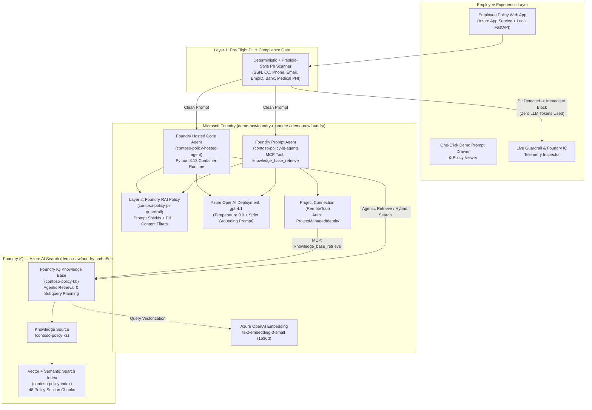

# Official Solution Requirements & Architecture Document
**Project Title:** Contoso Enterprise Policy Assistant — Strictly Grounded RAG with Foundry IQ, Hosted Agents, and Multi-Layer PII Guardrails  
**Prepared For:** Enterprise Customer Executive & Technical Architecture Review  
**Prepared By:** Microsoft Cloud & AI Solution Architecture  
**Date:** November 9, 2026  
**Target Azure Subscription:** `<your-azure-subscription-id>`  
**Resource Group:** `rg-demo-newfoundry`  

---

## 1. Executive Summary
Enterprise employees frequently struggle to locate accurate, up-to-date answers across fragmented corporate policy repositories covering Human Resources, FMLA/Medical Leave, Corporate Travel (including high-risk fraud jurisdictions such as Las Vegas and New York City), and FLSA Overtime compliance. Generic AI assistants pose three unacceptable enterprise risks in this domain:
1. **Hallucination & Unverified Inference:** Inventing policy exceptions, dollar thresholds, or legal entitlements not present in official company policy documents.
2. **External Web Contamination:** Pulling general labor laws or public internet norms instead of internal corporate rules.
3. **Employee PII & PHI Leakage:** Employees inadvertently pasting Social Security Numbers (SSNs), credit card numbers, phone numbers, personal emails, employee IDs, bank account numbers, or confidential medical/FMLA diagnoses into the chat prompt.

This solution delivers a **zero-hallucination, strictly grounded Employee Policy Assistant** built on **Microsoft Foundry (v2)** and **Foundry IQ (Azure AI Search Agentic Retrieval)**. It combines a **Foundry Prompt Agent**, a **Foundry Code-Based Hosted Agent**, a **Foundry IQ Knowledge Base**, and a **Triple-Layer PII & Grounding Guardrail Architecture** exposed through an interactive enterprise Web Application.

---

## 2. Business & Functional Requirements

### 2.1 Policy Corpus Coverage (FR-01)
The solution must ingest, chunk, vectorize, and index **10 authoritative internal policy documents** across four enterprise domains:

| Policy ID | Document Title | Domain | Key Policy Rules & Demo Scenarios |
| :--- | :--- | :--- | :--- |
| **HR-001** | Employee Code of Conduct, Ethics & Conflict of Interest | Human Resources | $25 swag limit; $25.01–$100 gift disclosure within 5 days; $0 cash/gift card rule; $0 government official limit; 15 hr/wk moonlighting cap. |
| **HR-002** | Remote, Hybrid, and Flexible Work Arrangement Policy | Human Resources | 3 days/week hybrid (Tue/Wed anchor days); 9 AM–3 PM core hours; $600 ergonomic stipend (50% clawback <12 mos); $65/mo remote internet stipend; 20-day domestic WFA limit. |
| **HR-003** | Paid Time Off (PTO), Sick Leave, Bereavement & Civic Duty | Human Resources | Tenure tiers (15/20/25 days); 40-hour rollover cap; 80 hrs front-loaded sick leave (>3 days requires doctor's note); 10 days Tier-1 bereavement; 10 days paid jury duty. |
| **HR-004** | Performance Management, Annual Review & PIP Policy | Human Resources | 1–5 rating scale (150%/120%/100%/0–50%/0% bonus multipliers); 60-day formal PIP after two coaching sessions over 30 days; weekly written recaps within 24 hours. |
| **HR-005** | Tuition Reimbursement, Certifications & L&D Policy | Human Resources | $5,250/yr IRS academic cap (100% for A/B, 50% for B-/C, 0% below C); 12-month repayment clawback (100% <6 mos, 50% 6–12 mos); separate $2,000 certification budget (no clawback). |
| **LEAVE-001** | Family and Medical Leave Act (FMLA) & Parental Leave | Leave & Benefits | 12 months tenure + 1,250 hours worked + 50 employees/75 miles; 12 weeks unpaid job protection (26 weeks military caregiver); 6 weeks 100% paid parental leave; 15-day WH-380 certification deadline via Sedgwick. |
| **TRV-001** | Global Corporate Travel, Lodging & Expense Policy | Travel & Expense | Mandatory Concur booking; $225/night standard domestic hotel cap; $75/day meal cap ($18/$22/$35) with no alcohol on solo meals; $25 receipt rule; 30-day submission window. |
| **TRV-002** | High-Risk City Travel Addendum — Las Vegas, NV | Travel (Fraud Control) | Dual pre-approval (VP + Travel Risk Desk) 14 days prior + conference badge proof; $185/night Sun–Thu ($250 convention block); Friday/Saturday nights banned without SVP sign-off; $0.01+ itemized receipt rule; casino/nightclub/dayclub/pool/ATM hard-blocked. |
| **TRV-003** | High-Risk City Travel Addendum — New York City, NY | Travel (Fraud Control) | VP pre-approval for >3 nights; Amtrak mandate from BOS/PHL/DC; $375/night Manhattan (<96th St) / $265 outer boroughs; private black-car/Uber Black ban; Subway-first 6 AM–9 PM; $95 airport taxi cap; $95/day meals; $0.01+ receipt rule; split-check AI fraud detection. |
| **COMP-001** | Overtime Compensation, FLSA Classification & Timekeeping | Compensation & Payroll | Non-exempt 1.5x over 40 hrs/wk; 2.0x over 12 hrs/day, >8 hrs on 7th consecutive day, or Company Holidays; 60 hr/wk hard safety cap; written pre-approval required (>8 hrs OT requires Director/VP); unauthorized OT must still be paid but triggers 3-step discipline. |

### 2.2 Strict Grounding & Zero-Inference Mandate (FR-02)
1. **Closed-World Assumption:** The agent must answer questions **exclusively** using facts explicitly stated in the retrieved chunks from the 10 policy documents.
2. **No Web Search or General Knowledge:** No `web_search` or Bing grounding tools may be attached. The agent must never supplement answers with general US labor laws, IRS rules, or industry norms not written in the policy text.
3. **Mandatory Inline Citations:** Every factual claim, dollar limit, timeframe, or approval rule must include an inline citation referencing the exact Policy ID and Section (e.g., `【TRV-002†Section 3: Las Vegas Lodging Controls】`).
4. **Deterministic Refusal on Unstated/Out-of-Scope Topics:** If a user asks about a topic not covered in the 10 documents (e.g., pet insurance, sabbatical leave, cryptocurrency payroll, stock option vesting, or travel to Tokyo/London), the agent must explicitly state that the information is not present in the official Contoso policy documents and refuse to speculate.

### 2.3 Multi-Layer PII & Compliance Guardrails (FR-03)
Employees frequently paste personal details when asking HR or leave questions (e.g., *"My SSN is 123-45-6789 and I was diagnosed with stage-2 lymphoma, how do I file FMLA?"*). The system must enforce **defense-in-depth PII prevention**:
1. **Layer 1 — Pre-Flight Deterministic & NLP PII Gate (Input Interception):**
   - Scans every incoming user message *before* any LLM call or search query is executed.
   - Detects and blocks: **U.S. Social Security Numbers (SSN)**, **Credit/Corporate Card Numbers (Luhn/pattern)**, **Phone Numbers**, **Personal/Work Email Addresses**, **Employee IDs (`EMP-XXXXXX`)**, **Bank Routing/Account Numbers**, **Driver's License / Passport numbers**, and **Specific Medical Diagnoses / PHI keywords**.
   - When triggered, immediately halts processing (0 tokens sent to the LLM), logs a redacted audit event, and returns a clear, helpful compliance notice instructing the user to re-submit their policy question without personal identifiers.
2. **Layer 2 — Microsoft Foundry Native RAI Guardrail Policy (`contoso-policy-pii-guardrail`):**
   - Configured at the Azure AI Foundry account level and attached to both the Foundry Agent (`rai_config.rai_policy_name`) and model deployments.
   - Enforces Azure AI Content Safety **Prompt Shields** (User Prompt Attack / Jailbreak & Indirect Prompt Injection on Tool Calls), **PII detection**, and core harm filters (`Hate`, `Violence`, `Sexual`, `Selfharm` at `Medium` threshold).
3. **Layer 3 — System Prompt Guardrail & Output Sanitization:**
   - Instructs the agent to refuse requests to process, store, or validate personal employee records, medical diagnoses, or financial account numbers, and directs employees to the encrypted **Sedgwick Leave Portal** (`LEAVE-001`) or **Concur** (`TRV-001`).

---

## 3. Solution Architecture (Microsoft Foundry + Foundry IQ)

### 3.1 Why Foundry IQ + Foundry Agent Service?
1. **Foundry IQ (`knowledge_base_retrieve` via MCP):**
   - Unlike naive single-query vector search, **Foundry IQ** uses Azure AI Search's **Agentic Retrieval pipeline** (`2026-08-01-preview`).
   - When a user asks a complex comparative question (e.g., *"Compare the hotel rate caps, receipt rules, and pre-approval requirements between standard travel, Las Vegas, and New York City"*), Foundry IQ decomposes the question into parallel subqueries across the knowledge source, applies **Semantic Ranker (`semantic_config`)** + **HNSW Vector Search (`text-embedding-3-small`)**, and returns structured extractive chunks with document citations.
2. **Dual Agent Deployment Pattern:**
   - **Foundry Prompt Agent (`contoso-policy-iq-agent`):** Declarative agent registered in Foundry Agent Service using `PromptAgentDefinition`, connected to Foundry IQ via a managed `RemoteTool` MCP connection (`ProjectManagedIdentity`) and protected by `rai_config`. Zero infrastructure to maintain and testable directly in the Foundry Portal Playground.
   - **Foundry Hosted Agent (`contoso-policy-hosted-agent`):** Deployed from Python source code via `create_version_from_code` (`HostedAgentDefinition`, `python_3_13`, `remote_build`), allowing custom pre-flight PII guardrail middleware and custom telemetry payloads inside Foundry's managed container runtime.
3. **Enterprise Web App (`contoso-policy-web-*`):**
   - Deployed to **Azure App Service** in `rg-demo-newfoundry` (and runnable locally), providing a polished employee portal with a live **Guardrail & Foundry IQ Inspector** so customer stakeholders can see every subquery, retrieved policy chunk, citation, and PII block in real time.

---

## 4. Non-Functional Requirements (NFRs)
- **NFR-01 Security & Keyless Auth:** All service-to-service communication between Microsoft Foundry, Azure AI Search (Foundry IQ), and Azure OpenAI uses **Microsoft Entra ID Managed Identities** (`SystemAssigned` identity on `demo-newfoundry` and `demo-newfoundry-srch-r5nb` with `disableLocalAuth: true`).
- **NFR-02 Auditability & Observability:** Every query, retrieved chunk ID, citation, latency metric, and PII guardrail interception is logged and surfaced in the UI telemetry inspector and Application Insights (`demo-newfoundry-appinsights-9611`).
- **NFR-03 Infrastructure as Code (IaC) & Reproducibility:** All Azure resources, RBAC assignments, index schemas, Foundry IQ knowledge bases, RAI policies, and agent definitions are provisioned via Bicep (`infra/main.bicep`) and automated Python scripts (`scripts/`).
